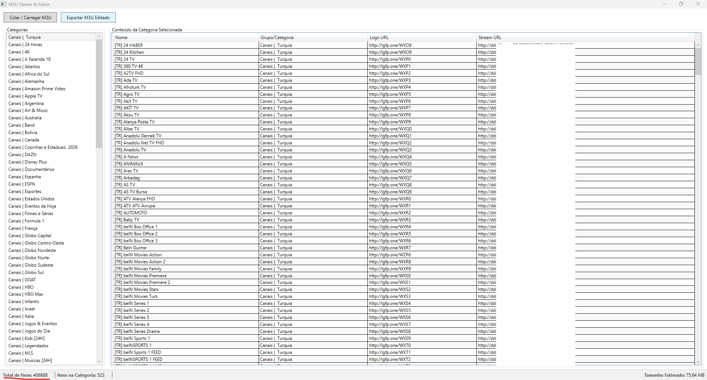

# M3U File Editor

A desktop application built with **C#**, **WPF (XAML)**, and **.NET 8 (`net8.0-windows`)** designed to load, filter, and bulk-edit large `.m3u` and `.m3u8` playlist files efficiently.

Solves the slowdowns and manual effort of opening massive IPTV/media playlists in standard text editors to reorganize channels, remove unwanted entries, fix groups, and batch-update metadata.

## Screenshot



## Features
- **Fast loading of large playlists:** reads and handles thousands of `.m3u` / `.m3u8` entries smoothly.
- **Bulk editing:** batch updates for groups (`group-title`), channel names, logos (`tvg-logo`), IDs, and stream URLs.
- **Search and filtering:** quick lookup by channel name, group/category, or URL substring.
- **Cleanup and organization:** bulk removal of duplicate channels, entire categories, or selected items, along with list reordering.
- **Clean export:** saves the resulting playlist while preserving standard `#EXTM3U` / `#EXTINF` formatting for media players.

## Tech Stack
- **C#** & **.NET 8 (`net8.0-windows`)**
- **WPF (Windows Presentation Foundation) & XAML**

## Getting Started

### Prerequisites
- Windows 10 or 11 (x64)
- [.NET 8 SDK](https://dotnet.microsoft.com/download/dotnet/8.0) installed (or Visual Studio with the **.NET desktop development** workload)

### How to Run
1. Clone the repository:
   ```bash
   git clone [https://github.com/wmonteiro/m3u-file-editor.git](https://github.com/wmonteiro/m3u-file-editor.git)